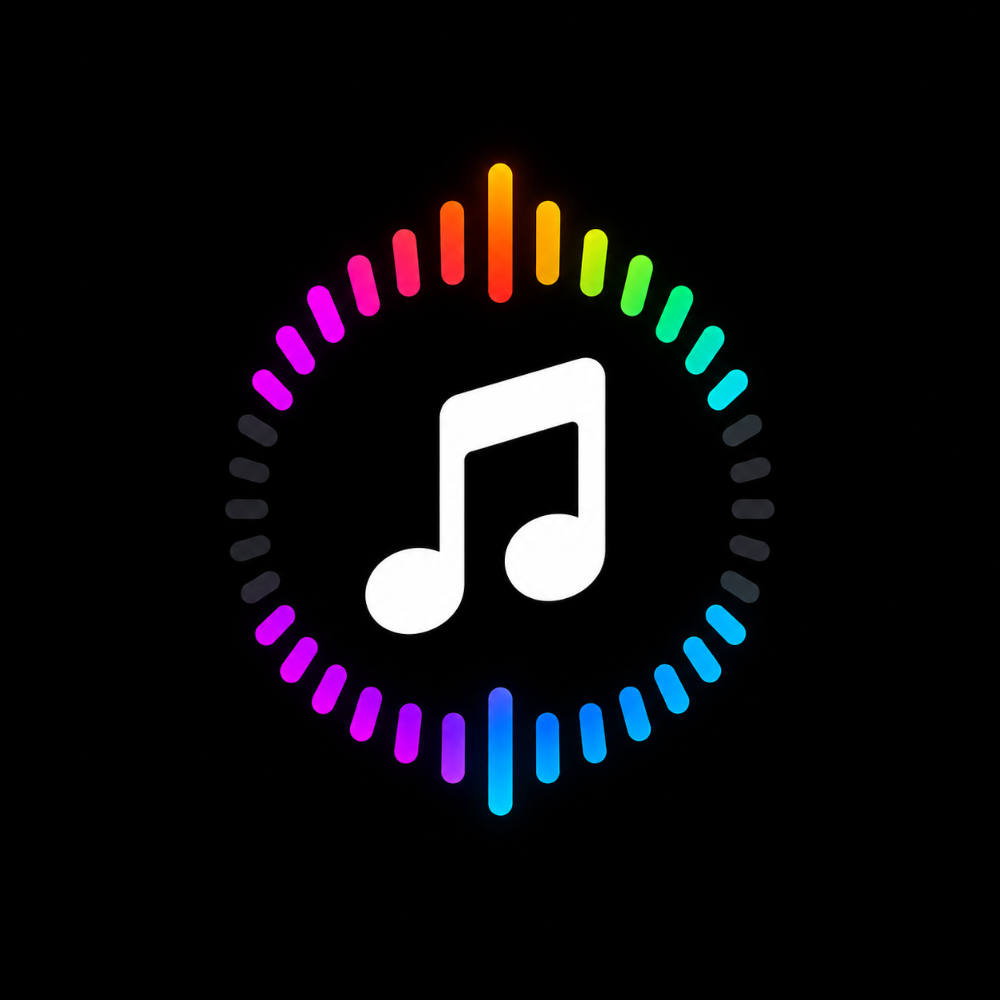
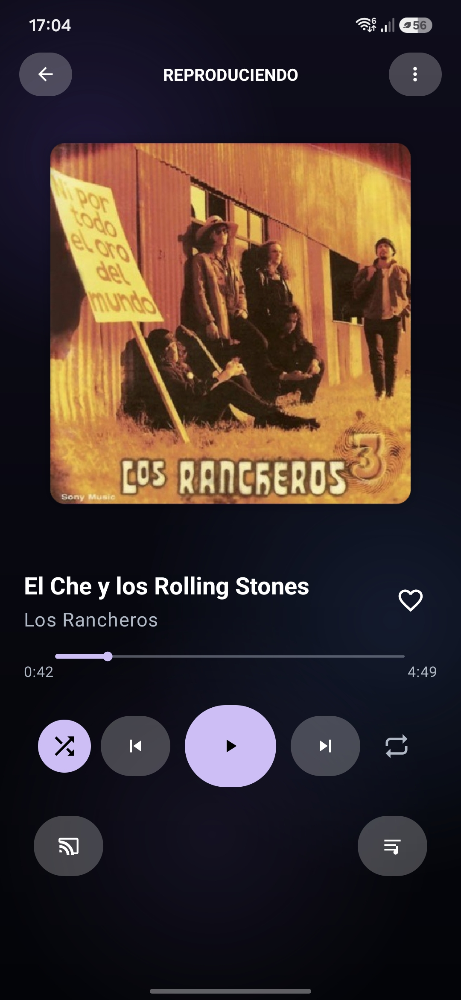
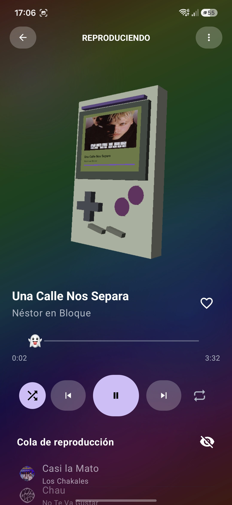
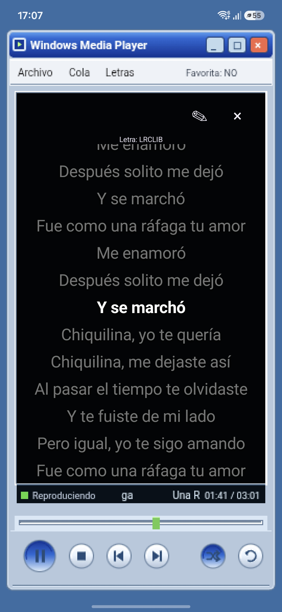
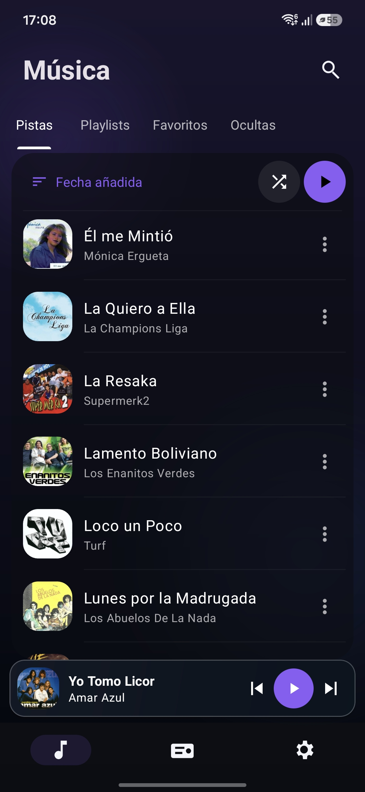
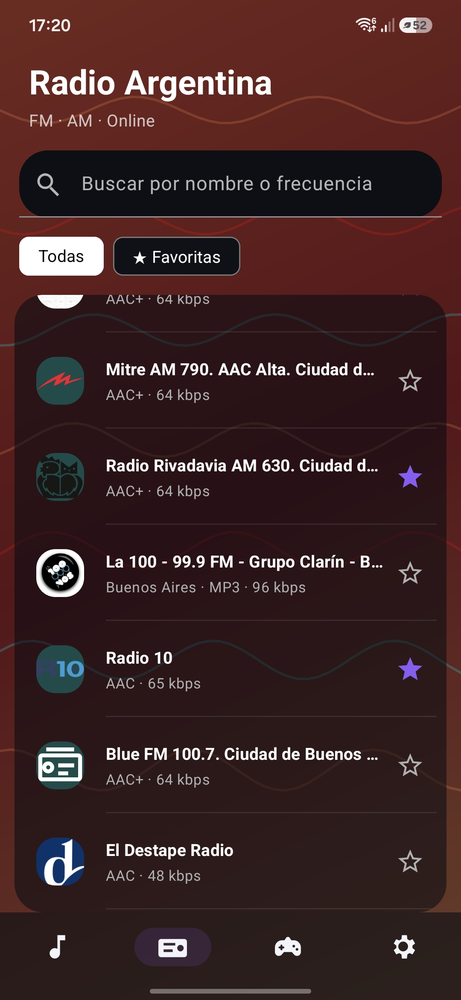
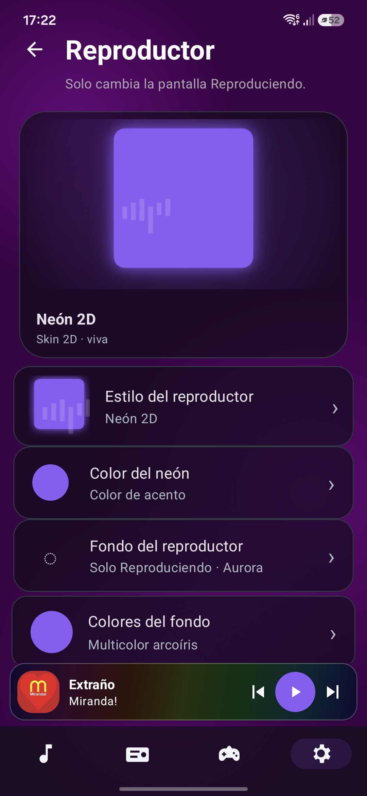
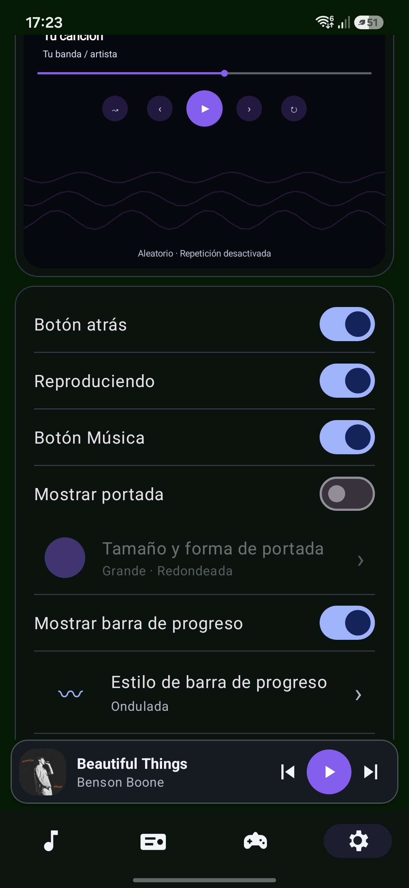
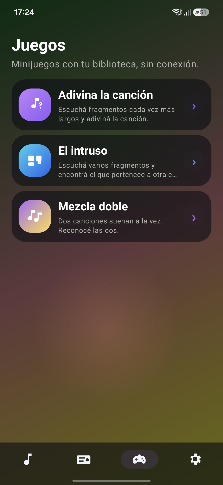

<div align="center">



# Nebula

### Tu música. Tu reproductor. Tus reglas.

Un reproductor de música para Android pensado para escuchar tu biblioteca local **sin cuentas, sin suscripciones y sin depender de internet**.  
Radio online, letras sincronizadas, skins, visualizadores, playlists, juegos y muchas opciones de personalización.

[](https://github.com/ezepalleros/Nebula-app-/releases/latest)
[](#requisitos)
[](#tecnología)
[](https://github.com/ezepalleros/Nebula-app-/stargazers)

**[⬇️ Descargar la última versión](https://github.com/ezepalleros/Nebula-app-/releases/latest)**

</div>

---

## ✨ Qué es Nebula

Nebula nació porque quería un reproductor que pudiera adaptar a mi gusto en vez de adaptarme yo al reproductor.

La música local es la protagonista: la app lee tu biblioteca desde Android, funciona sin conexión y mantiene la reproducción en segundo plano. La radio y las búsquedas opcionales de letras y portadas sí necesitan internet.

<table>
<tr>
<td width="50%"><b>🎵 Biblioteca local</b><br>Canciones, álbumes, artistas, favoritos, playlists, carpetas configurables y edición de metadatos.</td>
<td width="50%"><b>🎨 Personalización</b><br>Skins 2D y 3D, visualizadores, fondos, colores, tipografías, animaciones y elementos visibles.</td>
</tr>
<tr>
<td><b>🎤 Letras</b><br>Visor integrado, letras LRC sincronizadas, karaoke, edición, búsqueda con LRCLIB y ajuste manual del tiempo.</td>
<td><b>📻 Radio Argentina</b><br>Emisoras online, búsqueda y favoritos, con reproducción en segundo plano.</td>
</tr>
<tr>
<td><b>🔋 Reproducción y ahorro</b><br>Crossfade, gapless, normalización, controles externos y modo súper ahorro.</td>
<td><b>🎮 Minijuegos</b><br>Adivina la canción, El intruso y Mezcla doble, usando tu biblioteca.</td>
</tr>
</table>

---

## 🎧 Reproduciendo

Elegí entre el reproductor clásico, skins 3D y estilos inmersivos como **Reproductor XP** y **Teléfono clásico**. También hay visualizadores como **Anillo** y **Ecualizador 2D**.

<table>
<tr>
<td width="33%" align="center"></td>
<td width="33%" align="center"></td>
<td width="33%" align="center"></td>
</tr>
</table>

### Lo que podés personalizar

- Skins, temas y efectos visuales; algunos estilos incluyen sus propios ajustes.
- Portadas, tipografías, colores, degradados y fondos dinámicos.
- Estilos de barra de progreso y animaciones, incluida la opción de dejarlas quietas.
- Elementos visibles, botones del reproductor y gestos sobre la portada.
- Cola de reproducción como **botón o lista**, según tu preferencia.
- Visualización de barras de audio en los skins compatibles.

---

## 🎤 Letras sincronizadas

Consultá las letras desde la pantalla de reproducción, sin cambiar de aplicación.

- Letras incrustadas en los archivos de música y archivos LRC.
- Búsqueda individual o masiva con **LRCLIB**, con selección manual de resultados.
- Letras completas con resaltado o modo karaoke.
- Importar, exportar y editar letras por línea.
- **Sincronizar**: ajustar un desfase por canción sin sobrescribir el archivo original.
- Tamaño, tipografía, colores, fondo y pantalla completa configurables.
- Opción de no abrir Letras al tocar la portada.

La reproducción de música local y las letras ya guardadas siguen disponibles sin conexión.

---

## 📚 Tu biblioteca, sin vueltas

<table>
<tr>
<td width="48%" align="center"></td>
<td width="52%">

### Música local primero

Nebula utiliza la biblioteca de Android mediante MediaStore.

- Canciones, álbumes, artistas y playlists.
- Favoritos, filtros y orden configurable.
- Ocultar carpetas y audios que no quieras ver.
- Mini reproductor para controlar la música desde otras pantallas.
- Editor de título, artista, álbum y portada.
- Opción de escribir cambios de metadatos en archivos compatibles, con manejo de permisos y respaldo.

No necesitás registrarte para escuchar tus canciones.

</td>
</tr>
</table>

### Portadas online

Desde el editor podés buscar portadas en **Deezer** y **iTunes** sin claves de API. La búsqueda es manual y ofrece candidatos para elegir, además de ajustes de calidad y opción de usar solo Wi-Fi. La portada elegida se aplica al guardar la canción.

---

## 📻 Radio

<table>
<tr>
<td width="52%">

Radio online integrada en Nebula, independiente de la biblioteca local.

- Búsqueda de emisoras argentinas.
- Emisoras favoritas y navegación entre favoritas.
- Controles de reproducción en segundo plano.
- Opciones de personalización de la pantalla de radio.

> La radio requiere internet; la biblioteca musical local no.

</td>
<td width="48%" align="center"></td>
</tr>
</table>

---

## 🎨 Personalización

<table>
<tr>
<td width="50%" align="center"></td>
<td width="50%" align="center"></td>
</tr>
</table>

Organizá la app a tu manera desde **Apariencia, Navegación, Reproductor, Letras, Audio, Radio, Biblioteca y Batería**. En **Información** podés comprobar actualizaciones y consultar los reconocimientos a servicios y bibliotecas utilizadas.

---

## 🎮 Juegos

<div align="center">

</div>

Usá tus canciones para jugar **Adivina la canción**, **El intruso** y **Mezcla doble**. Los juegos funcionan con la biblioteca que ya tenés descargada y pueden ocultarse desde las opciones de la app.

---

## 🔊 Audio y reproducción

Nebula utiliza **AndroidX Media3 / ExoPlayer** y un motor con dos reproductores para gestionar las transiciones de audio.

- Crossfade y gapless configurables.
- Fade opcional al pausar o reanudar.
- Normalización de volumen.
- Aleatorio, repetición y cola de reproducción.
- Comportamiento configurable del botón **Anterior**.
- Controles desde notificaciones, auriculares, Bluetooth y pantalla de bloqueo.
- Modo súper ahorro para reducir los efectos visuales y otras tareas costosas.

---

## 🚀 Instalación

1. Entrá en **[Releases](https://github.com/ezepalleros/Nebula-app-/releases/latest)**.
2. Descargá el APK de la última versión.
3. Abrilo en tu teléfono y, si Android lo solicita, autorizá la instalación desde esa fuente.
4. Al abrir Nebula, concedé los permisos necesarios para acceder a tu música y mostrar notificaciones.

### Requisitos

- **Android 8.0 (API 26) o superior**.
- Permiso para acceder a archivos de audio.
- Permiso de notificaciones en las versiones de Android que lo requieren.
- Internet únicamente para la radio, las actualizaciones y las funciones online opcionales.

---

## 🛠️ Tecnología

Nebula está desarrollada de forma nativa para Android.

| Componente | Tecnología |
|---|---|
| Lenguaje e interfaz | Java y XML Views |
| Reproducción | AndroidX Media3 / ExoPlayer / MediaSession |
| Biblioteca | MediaStore |
| Persistencia | Room y preferencias locales |
| Imágenes y metadatos | Glide y jaudiotagger |
| Servicios online | LRCLIB, Deezer, iTunes y Radio Browser |
| Skins especiales | Canvas, WebView y JavaScript |
| SDK mínimo / objetivo | 26 / 35 |

No utiliza Kotlin ni Jetpack Compose.

---

## 🧑‍💻 Compilar desde el código fuente

```bash
git clone https://github.com/ezepalleros/Nebula-app-.git
cd Nebula-app-
```

Abrí la carpeta en Android Studio y sincronizá Gradle.

Para generar un APK firmado de release utilizá **Build → Generate Signed App Bundle or APK → APK**.

---

## 🔄 Actualizaciones

Desde **Información**, Nebula puede comprobar la última versión publicada en GitHub Releases y abrir la página oficial de descarga.

**[Ver todas las releases →](https://github.com/ezepalleros/Nebula-app-/releases)**

---

## ❤️ Apoyar el proyecto

Si Nebula te sirve y querés bancar su desarrollo:

| | |
|---|---|
| **Alias** | `eze.palleros` |
| **CVU** | `0000003100067543622083` |
| **Nombre** | Ezequiel German Palleros Ibarra |

No hace falta donar para usar ninguna función de Nebula.

---

## 🤝 Contribuir

Issues, reportes de bugs e ideas son bienvenidos. Si encontrás un problema, incluí el modelo de teléfono, la versión de Android, los pasos para reproducirlo y, cuando sea posible, una captura o video.

**[Abrir un issue](https://github.com/ezepalleros/Nebula-app-/issues/new)**

---

## 👤 Créditos

**Desarrollado por [elequiweb](https://github.com/ezepalleros).**

Nebula es un proyecto independiente para Android. Las herramientas, bibliotecas y servicios externos se reconocen en la sección **Información → Reconocimientos** de la app.

<div align="center">

### 🌌 Nebula

**Poné play. El resto lo decidís vos.**

[Descargar](https://github.com/ezepalleros/Nebula-app-/releases/latest) · [Código fuente](https://github.com/ezepalleros/Nebula-app-) · [Reportar un problema](https://github.com/ezepalleros/Nebula-app-/issues)

</div>
